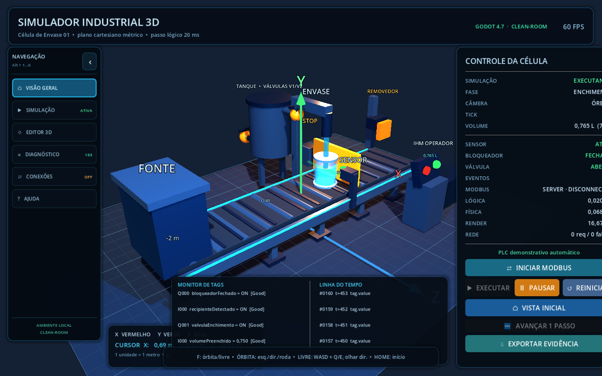
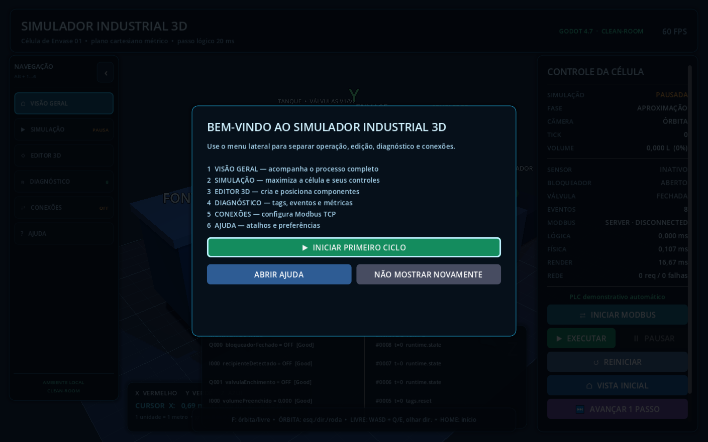
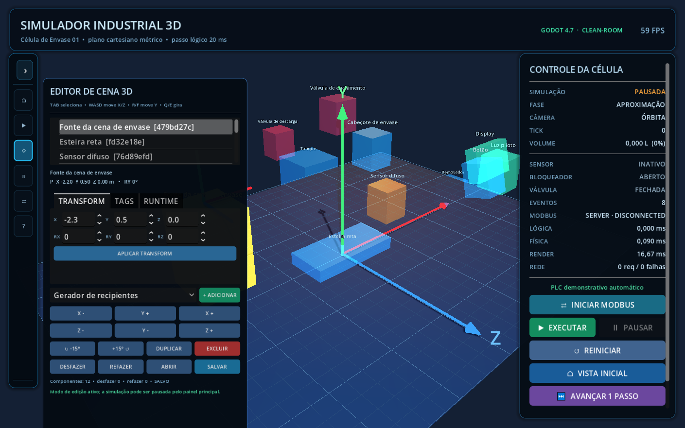
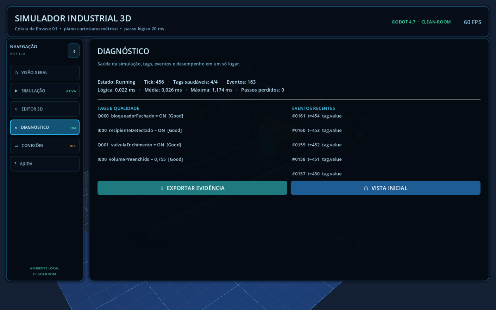

# Simulador Industrial

[](https://github.com/GahbMontoli/industrial-simulator-3d/actions/workflows/ci.yml)

Simulador industrial 3D independente, desenvolvido por processo clean-room.



## Estado atual

O MVP entrega uma célula de envase 3D executável e editável:

- plano cartesiano métrico `X/Y/Z` com grade de `0,25 m` e marcações de `1 m`;
- câmeras orbital e livre, com pan, zoom, seleção de pivô e restauração da vista;
- fonte, esteira, recipiente, tanque, válvulas, sensor, bloqueador, removedor e IHM autorais;
- interface em português com menu lateral, seis áreas de trabalho, atalhos `Alt+1…6` e navegação por teclado;
- primeira execução guiada, escala ajustável, página inicial configurável e confirmações para ações críticas;
- controles de executar, pausar, reiniciar e passo único, com métricas, tags e timeline;
- editor 3D com árvore, catálogo, gizmo, propriedades, tags, força/falhas, undo/redo e persistência;
- catálogo extensível com pacotes `.silabcomponent`, instalação pelo editor e validação contra travessia de diretório ou código executável;
- PLC demonstrativo automático para executar o ciclo completo;
- Modbus TCP cliente/servidor com FC01/02/03/04/05/06/15/16, monitor, qualidade e reconexão;
- relógio lógico de passo fixo;
- estados de execução, pausa e reset;
- tags tipadas e direcionadas do ponto de vista do PLC;
- qualidade, forçamento e falhas auditáveis;
- formato de cena JSON próprio, versionado, migrável e limitado a 8 MiB;
- cenário autoral de célula de envase;
- aplicativo de console para validação headless;
- campanha headless de injeção de falhas com métricas de divergência e exportação CSV;
- testes automatizados.

## Requisitos

- Windows x64 com OpenGL 3.3 ou Vulkan 1.0;
- .NET SDK 8 ou superior;
- Godot 4.7.2 .NET, edição Mono/.NET.

## Executar em 3D

```powershell
git clone https://github.com/GahbMontoli/industrial-simulator-3d.git
Set-Location .\industrial-simulator-3d
& .\Start-Simulador3D.ps1
```

Por padrão, o script procura a versão portátil em `.tools\godot-4.7.2`. Para usar uma instalação em outro diretório:

```powershell
& .\Start-Simulador3D.ps1 -GodotPath 'C:\caminho\para\Godot_v4.7.2-stable_mono_win64.exe'
```

Na primeira abertura, a tela de boas-vindas apresenta um ciclo seguro de quatro etapas. O menu lateral organiza o programa em **Visão geral**, **Simulação**, **Editor 3D**, **Diagnóstico**, **Conexões** e **Ajuda**.



Navegação da interface:

- `Alt+1…6`: abrir diretamente cada área;
- clique no botão superior do menu para expandir ou recolher;
- `Tab`/`Shift+Tab`: mover o foco entre controles; `Enter` ou `Espaço`: acionar o controle focado;
- em **Ajuda**, ajustar escala, página inicial, tela de boas-vindas e confirmações de segurança.

Controles da câmera:

- botão esquerdo + arrastar: órbita;
- botão direito ou meio + arrastar: pan;
- roda: zoom;
- duplo clique no piso: novo pivô;
- `Home`: restaurar vista isométrica.
- `F`: alternar entre câmera orbital e livre;
- câmera livre: `WASD` movimenta, `Q/E` desce/sobe e botão direito controla o olhar.

Editor 3D:

- `F2`: abrir/fechar;
- `Tab`: selecionar o próximo componente;
- `WASD`, `R/F`, `Q/E`: mover e girar com snap;
- `Ctrl+D`, `Delete`, `Ctrl+Z`, `Ctrl+Y`, `Ctrl+S`: duplicar, excluir, desfazer, refazer e salvar.
- **INSTALAR COMPONENTE...**: instala um pacote local e recarrega o catálogo sem reiniciar.

O formato, as garantias de segurança e o pacote de motor demonstrativo estão em
[COMPONENT_PACKAGES.md](docs/COMPONENT_PACKAGES.md).



Diagnóstico e conexões:

- **Diagnóstico** reúne saúde das tags, métricas, eventos e exportação de evidências em painéis roláveis;
- **Conexões** permite configurar papel cliente/servidor, host, porta e Unit ID do Modbus TCP sem editar JSON;
- a configuração é validada antes de substituir a conexão ativa; a cena deve ser salva no Editor 3D para reutilização futura.



## Executar validação no console

```powershell
dotnet run --project .\src\SimuladorIndustrial.Cli -- .\samples\celula-envase.scene.json
```

Para comparar o ciclo nominal com falhas determinísticas de sensor e atuador sem
abrir a interface 3D:

```powershell
dotnet run --project .\src\SimuladorIndustrial.Cli -- `
  --fault-study `
  --scene .\samples\celula-envase.scene.json `
  --output .\artifacts\fault-study.csv
```

A campanha mede volume físico e indicado, tempo até o alvo, válvula ativa na
capacidade e divergência entre comando PLC e estado efetivo. Interpretação e
limites estão em [Estudo de injeção de falhas](docs/FAULT_STUDY.md).

## Testar

```powershell
dotnet test .\SimuladorIndustrial.sln
```

## Gerar pacote Windows

Os templates oficiais .NET do Godot têm aproximadamente 1,2 GB e não são versionados. Na primeira exportação:

```powershell
& .\scripts\Setup-GodotExportTemplates.ps1
& .\scripts\Export-Windows.ps1
& .\scripts\Test-WindowsPackage.ps1
```

O instalador de templates confere tamanho e SHA-256 do arquivo oficial antes de instalá-lo. A exportação compila, testa, cria o pacote x86_64 em `dist`, inclui avisos de licença/SBOM e gera `SHA256SUMS.txt`. O verificador extrai o ZIP em staging isolado, confere caminhos, arquivos, manifesto, SBOM e metadados, executa um smoke test visual e remove o staging. O executável ainda não possui assinatura de código.

Pacote `0.2.0` validado localmente:

- `dist\SimuladorIndustrial3D-0.2.0-windows-x86_64.zip`
- SHA-256: `F4860BC87AD197C97174D66E81F3AB6975F827D3BF847918A9B5FB96BA7EF9EB`

O ZIP foi extraído em uma pasta isolada; o executável exportado iniciou no Windows, abriu a página de conexões, gerou uma captura e encerrou com código zero. Os 206 arquivos do manifesto interno foram conferidos. Os artefatos de `dist` não são versionados e serão publicados separadamente em **Releases**. O ensaio OpenPLC de 60 minutos continua separado porque o OpenPLC Runtime não está instalado nesta máquina.

## Convenção de I/O

- `plcInput`: produzido pela simulação e lido pelo PLC.
- `plcOutput`: escrito pelo PLC e consumido pela simulação.

O núcleo rejeita escrita no sentido incorreto, valor de tipo incompatível e colisão de endereço dentro do mesmo espaço lógico.

O papel `server` expõe entradas discretas/registradores de entrada e aceita comandos em coils/holding registers. O papel `client` sincroniza periodicamente as quatro áreas remotas, marca a qualidade em falhas e tenta reconectar automaticamente. O mapeamento completo está em [MANUAL_OPERACAO.md](docs/MANUAL_OPERACAO.md).

## Clean-room

Este projeto não reutiliza código, DLLs, cenas, modelos, texturas, ícones, sons, documentação ou identidade visual do Factory I/O. Consulte [OBSERVACOES.md](docs/clean-room/OBSERVACOES.md), [MATRIZ_REQUISITOS_FONTES.md](docs/clean-room/MATRIZ_REQUISITOS_FONTES.md), [PROIBICOES.md](docs/clean-room/PROIBICOES.md), [REQUISITOS.md](docs/clean-room/REQUISITOS.md), [THIRD_PARTY_NOTICES.md](THIRD_PARTY_NOTICES.md) e a [SBOM SPDX](sbom/simulador-industrial.spdx.json).

O ensaio prolongado com OpenPLC é deliberadamente separado dos testes unitários. O roteiro e o modelo de evidência estão em [tests/interop](tests/interop/README.md); ele permanece não comprovado até uma execução real de 60 minutos.

